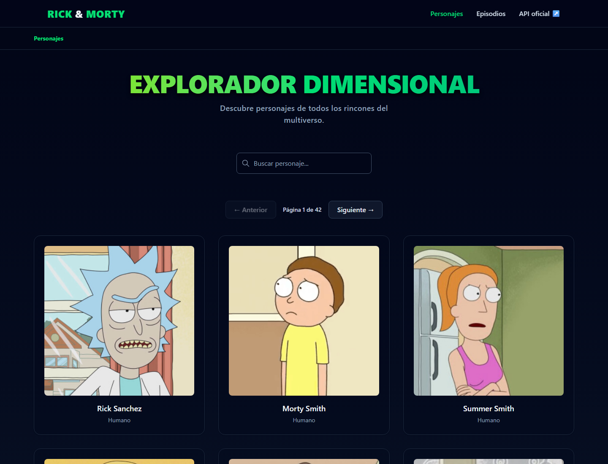
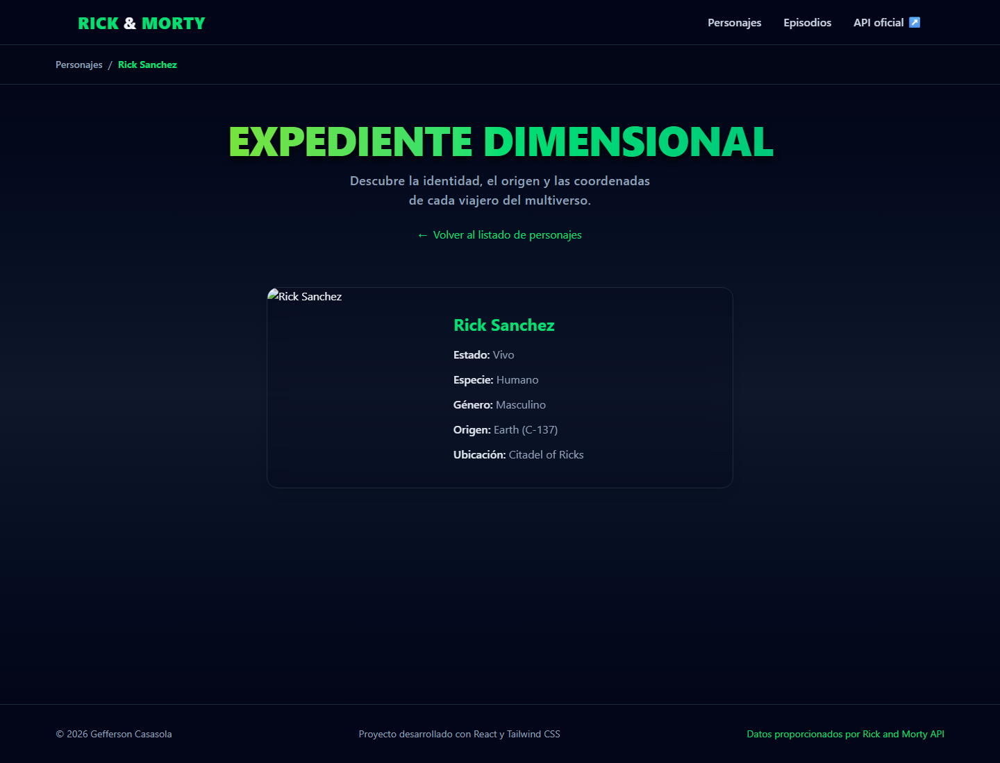

# Rick and Morty Explorer

A character and episode explorer built with React and the public [Rick and Morty API](https://rickandmortyapi.com/).





## Features

- **Character browser:** paginated grid with a debounced search (500 ms).
- **Shareable state:** the current page and search live in the URL (`/?page=2&name=rick`), so reloading or sharing a link keeps the view.
- **Character details:** status, species, gender, origin and location, with a back link that returns to the list you came from.
- **Episode browser:** paginated episode archive with season/episode badges and a character count.
- **Episode details:** air date and the full cast of the episode.
- **Nested navigation:** open a character from an episode and keep the episode in the breadcrumb.
- **Resilience:** request timeout with abort, one retry on network failures, explicit error states with a retry button, and an error boundary for render failures.
- **Accessibility:** skip link, focus moved to the main region on navigation, visible focus rings, semantic headings and landmarks, and announcements for loading/error states.
- **Responsive layout:** verified with no horizontal scroll from 320 px up.

## Tech Stack

- **React 19** – UI.
- **Vite 8** – dev server, build and code splitting.
- **React Router 7** – routing and nested routes.
- **Tailwind CSS 4** – styling.
- **Custom breadcrumbs** – replaces Material Tailwind (see [Notes](#notes)).
- **Vitest + Testing Library + MSW** – tests with a mocked API.
- **pnpm** – package manager.

## API

This project uses the public Rick and Morty API. No API key is required.

- Documentation: <https://rickandmortyapi.com/documentation>
- Base URL: `https://rickandmortyapi.com/api`

## Getting Started

Requirements: Node.js and pnpm.

```bash
git clone <YOUR_REPOSITORY_URL>
cd <PROJECT_DIRECTORY>
pnpm install
pnpm dev
```

Open the URL printed in the terminal, usually <http://localhost:5173>.

## Available Scripts

| Command | Description |
|---|---|
| `pnpm dev` | Start the development server. |
| `pnpm build` | Build for production. |
| `pnpm preview` | Serve the production build locally. |
| `pnpm lint` | Run ESLint. |
| `pnpm test` | Run the test suite once. |
| `pnpm test:watch` | Run the tests in watch mode. |
| `pnpm test:coverage` | Run the tests with a coverage report. |

## Routes

| Route | Description |
|---|---|
| `/` | Character browser. |
| `/personaje/:id` | Character details. |
| `/episodios` | Episode browser. |
| `/episodios/:episodioId` | Episode details and cast. |
| `/episodios/:episodioId/personaje/:personajeId` | Character details inside an episode. |
| `*` | Not-found page. |

## Project Structure

```text
src/
├── components/     # Navbar, footer, cards, search, pagination, states
├── helpers/        # API client and text translations
├── hooks/          # Data fetching, URL state and document title
├── pages/          # Route components
├── test/           # Test setup, MSW handlers and fixtures
├── App.jsx         # Lazy routes
└── main.jsx        # Entry point, router and error boundary
```

## Deployment

`pnpm build` writes a static site to `dist/`. Because the app uses client-side
routing, the host must serve `index.html` for unknown paths:

- **Vercel / Netlify:** add a rewrite of `/*` to `/index.html`.
- **GitHub Pages:** use a 404 fallback or a SPA redirect script.

No live demo is linked yet; the screenshots above were captured from a local
production build (`pnpm build && pnpm preview`).

## Notes

- **Material Tailwind was removed.** It pulled a full component library for a
  single breadcrumb and declared React 16–18 peer dependencies while the app
  runs React 19. A small in-house breadcrumb keeps the behaviour and brings the
  initial bundle down to ~266 kB (≈85 kB gzip).
- **API values are translated** for display (status, species, gender) so the
  Spanish UI never mixes languages; unknown values are shown as they arrive.

## Credits

Character and episode data provided by the [Rick and Morty API](https://rickandmortyapi.com/).

This is an independent fan-made application, not affiliated with the official
Rick and Morty franchise.
